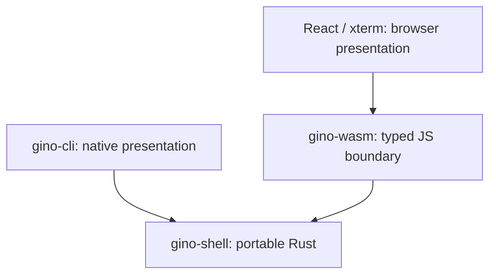

# Architecture — PR-08

## Present implementation

The Cargo workspace has three crates. `gino-shell` contains portable session, command/context, I/O/event, terminal adapter and cancellation contracts, plus a command registry, single-command parser and async interpreter with six built-ins. `gino-cli` now owns a Rustyline input loop, local executor, bounded output handoff and native rendering. Rustyline and signal-hook dependencies are native-only; the core remains dependency-free.

`apps/web` uses React, Vite and xterm.js. A labeled HTML input provides browser editing and keyboard shortcuts, while xterm renders sanitized output. The app loads the generated WASM module and sends complete command lines to Rust. Its TypeScript code owns only presentation, input history and lifecycle. See [browser terminal](BROWSER_TERMINAL.md).

## Intended dependency boundaries

Solid edges exist today.

Rust owns parsing, execution, commands and session state, and will own future virtual filesystem semantics. Native and WASM adapters invoke the same implementation. TypeScript will own DOM presentation, accessibility and browser integration only. The future optional API is independently deployed and is not on the local shell execution path.

## Portability and WASM build decision

The core must avoid host filesystem, environment, process, terminal and DOM dependencies. Native terminal handling belongs in `gino-cli`. Host-shell passthrough is prohibited. The integration test launches only the compiled CLI to check its output; production code launches no subprocesses.

Today `cargo build -p gino-shell --target wasm32-unknown-unknown --locked` checks that the core compiles for WASM. Its output is a Rust library, not a JavaScript-loadable shell. The native executable is deliberately excluded from that target check.

`gino-wasm` is a `cdylib`/`rlib` using `wasm-bindgen`, built by pinned wasm-pack 0.15.1 with target `web`. It calls the existing registry/interpreter and serializes typed output and session snapshots. Vite imports the generated JS and emits an explicit WASM URL asset. Generated binaries remain uncommitted; CI builds them before real Node and Chromium execution tests. See [bridge API and limits](WASM_BRIDGE.md).

Commands and adapters now return boxed local futures without `Send` or `Sync` requirements. Runtime polling and platform I/O belong to adapters. Per-execution cancellation wakes local futures and can race pending I/O. Tests exercise trait-object composition with `Rc`-backed state; the same tests are compile-checked for WASM, not executed there. I/O traits specify bounded buffering and pending writes; concrete streaming channels and backpressure arrive with PR-16. See [contract semantics](SHELL_CONTRACTS.md) for mutation, error and cancellation rules.

## Toolchain policy

Rust 1.99.1, Node 24.22.1 and pnpm 11.25.0 are pinned to versions available in the development environment. Direct JavaScript dependencies are exact versions and transitive versions are locked. Commit Cargo.lock and pnpm-lock.yaml; CI uses locked/frozen installation. Updates require re-running the same checks. CI validates Linux, core WASM compilation and the generated bridge in Node/Chromium; macOS and Windows are not claimed as tested.

## Deferred work

Parity and V0.1 audit PR-09. VFS, portfolio content, animation, AI and deployment remain at their roadmap PRs. No release milestone is achieved by this scaffold.

## Command registration (PR-03)

`CommandRegistry` owns `Box<dyn Command>` handlers and validated metadata. Canonical entries and direct aliases use ordered maps, so discovery is deterministic without a central command switch. Names share a collision-checked namespace; a failed registration changes nothing. Lookup and help use the same immutable registered metadata. See [registry rules](COMMAND_REGISTRY.md). The CLI initializes the six built-in handlers through `builtin_registry()`.

## Parsing (PR-04)

The parser is an independent, synchronous Rust module with owned words, quote provenance and UTF-8 byte spans. It returns either a complete single-command AST, blank input or a typed error. It has no registry or session dependency and performs no expansion or execution. A 64 KiB input cap bounds parsing work; unsupported composition syntax is rejected. See [grammar and error rules](SHELL_GRAMMAR.md). PR-05 connects parsing to registry dispatch and session lifecycle.

## Execution (PR-05)

`execute_line` borrows a registry, mutable session, I/O and per-execution cancellation token. It parses before lookup, dispatches independent handlers, reports typed failures and records the final status. `builtin_registry` registers help, echo, pwd, whoami, clear and exit. Read-only registry access in the command context keeps help current without a duplicate catalog. Sessions can close/reset without terminating a process. See [commands and lifecycle](COMMANDS.md). PR-06 supplies the native executor and adapter.

## Native presentation (PR-06)

Rustyline owns line editing and raw-mode cleanup. The native loop supplies a fresh token for each execution, bridges SIGINT into local cancellation, and routes stdout/stderr and structured clear events through a bounded handoff. It never dispatches host processes. The key-event adapter trait is not forced around a blocking line editor. See [native decisions, verification and limits](NATIVE_CLI.md).
