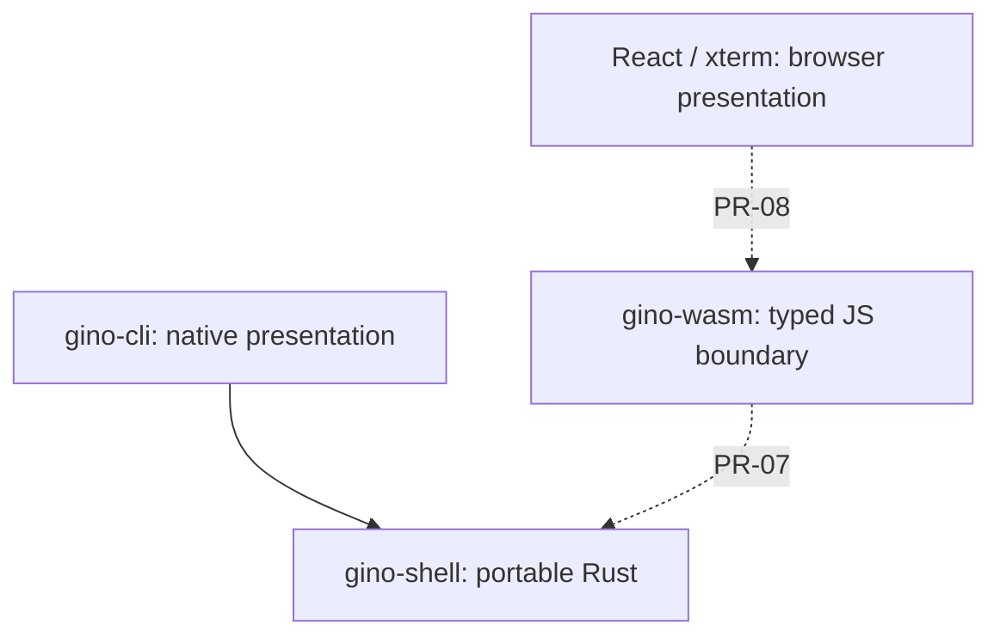

# Architecture — PR-04

## Present implementation

The Cargo workspace has two crates. `gino-shell` contains portable session, command/context, I/O/event, terminal adapter and cancellation contracts, plus a command registry and single-command parser. `gino-cli` still prints the development-status constant and exits. Concrete runtime integration is deferred. No third-party Rust dependencies are needed yet.

`apps/web` is a React/TypeScript/Vite page, tested with Vitest. It explicitly states that no shell is connected. Vite's built-in TSX transform is sufficient for this scaffold; React Fast Refresh can be added when needed. There is no xterm dependency or simulated terminal input yet.

## Intended dependency boundaries

Solid edges exist today. Dashed edges are planned.

Rust will own parsing, execution, commands, session state and virtual filesystem semantics. Native and browser adapters will invoke the same implementation. TypeScript will own DOM presentation, accessibility and browser integration only. The future optional API is independently deployed and is not on the local shell execution path.

## Portability and WASM build decision

The core must avoid host filesystem, environment, process, terminal and DOM dependencies. Native terminal handling belongs in `gino-cli`. Host-shell passthrough is prohibited. The integration test launches only the compiled CLI to check its output; production code launches no subprocesses.

Today `cargo build -p gino-shell --target wasm32-unknown-unknown --locked` checks that the core compiles for WASM. Its output is a Rust library, not a JavaScript-loadable shell. The native executable is deliberately excluded from that target check.

PR-07 will add `gino-wasm` as a `cdylib` using `wasm-bindgen`, with a pinned `wasm-pack` build pipeline targeting `web`. PR-08 will import that generated package into Vite. Generated binaries must remain uncommitted, and CI must build them before browser tests. No nonfunctional bridge crate or build script is included now.

Commands and adapters now return boxed local futures without `Send` or `Sync` requirements. Runtime polling and platform I/O belong to adapters. Per-execution cancellation wakes local futures and can race pending I/O. Tests exercise trait-object composition with `Rc`-backed state; the same tests are compile-checked for WASM, not executed there. I/O traits specify bounded buffering and pending writes; concrete streaming channels and backpressure arrive with PR-16. See [contract semantics](SHELL_CONTRACTS.md) for mutation, error and cancellation rules.

## Toolchain policy

Rust 1.99.1, Node 24.22.1 and pnpm 11.25.0 are pinned to versions available in the development environment. Direct JavaScript dependencies are exact versions and transitive versions are locked. Commit Cargo.lock and pnpm-lock.yaml; CI uses locked/frozen installation. Updates require re-running the same checks. CI initially validates Linux plus core WASM compilation; macOS and Windows are not claimed as tested.

## Deferred work

Commands PR-05; interactive native adapter PR-06; WASM bridge PR-07; browser terminal PR-08. VFS, portfolio content, animation, AI and deployment remain at their roadmap PRs. No release milestone is achieved by this scaffold.

## Command registration (PR-03)

`CommandRegistry` owns `Box<dyn Command>` handlers and validated metadata. Canonical entries and direct aliases use ordered maps, so discovery is deterministic without a central command switch. Names share a collision-checked namespace; a failed registration changes nothing. Lookup and help use the same immutable registered metadata. See [registry rules](COMMAND_REGISTRY.md). No runtime commands are registered in the scaffolds yet.

## Parsing (PR-04)

The parser is an independent, synchronous Rust module with owned words, quote provenance and UTF-8 byte spans. It returns either a complete single-command AST, blank input or a typed error. It has no registry or session dependency and performs no expansion or execution. A 64 KiB input cap bounds parsing work; unsupported composition syntax is rejected. See [grammar and error rules](SHELL_GRAMMAR.md). PR-05 will connect parsing to registry dispatch and session lifecycle.
