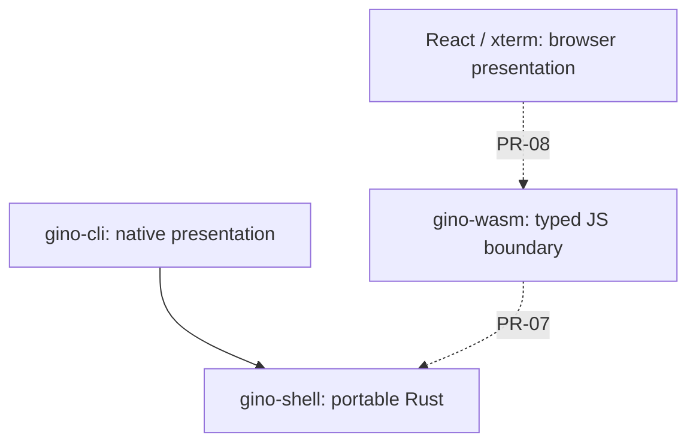

# Architecture — PR-01

## Present implementation

The Cargo workspace has two crates. `gino-shell` contains only a development-status constant; `gino-cli` prints it and exits. This establishes a native dependency on the portable crate without freezing shell contracts before PR-02. No third-party Rust dependencies are needed yet.

`apps/web` is a React/TypeScript/Vite page, tested with Vitest. It explicitly states that no shell is connected. Vite's built-in TSX transform is sufficient for this scaffold; React Fast Refresh can be added when needed. There is no xterm dependency or simulated terminal input yet.

## Intended dependency boundaries

Solid edges exist today. Dashed edges are planned.

Rust will own parsing, execution, commands, session state and virtual filesystem semantics. Native and browser adapters will invoke the same implementation. TypeScript will own DOM presentation, accessibility and browser integration only. The future optional API is independently deployed and is not on the local shell execution path.

## Portability and WASM build decision

The core must avoid host filesystem, environment, process, terminal and DOM dependencies. Native terminal handling belongs in `gino-cli`. Host-shell passthrough is prohibited. The integration test launches only the compiled CLI to check its output; production code launches no subprocesses.

Today `cargo build -p gino-shell --target wasm32-unknown-unknown --locked` checks that the core compiles for WASM. Its output is a Rust library, not a JavaScript-loadable shell. The native executable is deliberately excluded from that target check.

PR-07 will add `gino-wasm` as a `cdylib` using `wasm-bindgen`, with a pinned `wasm-pack` build pipeline targeting `web`. PR-08 will import that generated package into Vite. Generated binaries must remain uncommitted, and CI must build them before browser tests. No nonfunctional bridge crate or build script is included now.

PR-02 should design asynchronous contracts around local, non-`Send` futures so browser execution does not require threads. Runtime polling and platform I/O belong to adapters. That is a design direction, not an implemented API: PR-02 must validate borrowing, cancellation and event boundaries on both native and WASM targets. Bounded streaming and backpressure arrive with PR-16.

## Toolchain policy

Rust 1.99.1, Node 24.22.1 and pnpm 11.25.0 are pinned to versions available in the development environment. Direct JavaScript dependencies are exact versions and transitive versions are locked. Commit Cargo.lock and pnpm-lock.yaml; CI uses locked/frozen installation. Updates require re-running the same checks. CI initially validates Linux plus core WASM compilation; macOS and Windows are not claimed as tested.

## Deferred work

Contracts PR-02; registry PR-03; parser PR-04; commands PR-05; interactive native adapter PR-06; WASM bridge PR-07; browser terminal PR-08. VFS, portfolio content, animation, AI and deployment remain at their roadmap PRs. No release milestone is achieved by this scaffold.
